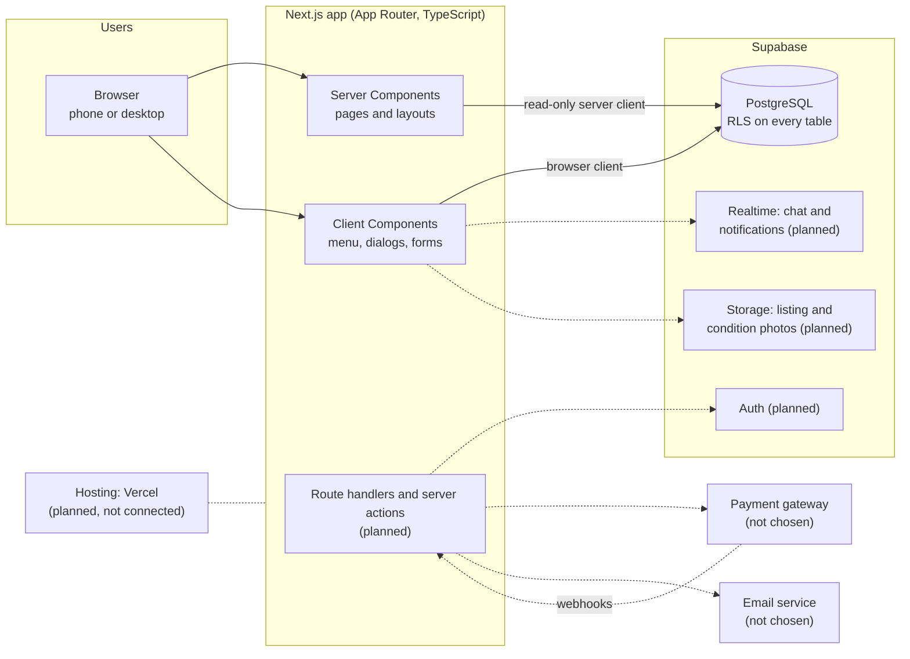

# Rentify architecture

A short overview of how Rentify is put together. It separates what is **built** from what is **planned**, so nobody builds against a piece that does not exist yet. For setup commands see the [README](../README.md); for the database contract see [supabase/README.md](../supabase/README.md).

## System overview

Solid arrows exist today. Dashed arrows are planned.

## What is built

| Layer         | What exists                                                                                                                                                                                                            |
| ------------- | ---------------------------------------------------------------------------------------------------------------------------------------------------------------------------------------------------------------------- |
| Pages         | Placeholder home (`/`) and a temporary component preview (`/ui-kit`). Both are static.                                                                                                                                 |
| Layout        | `app/layout.tsx` renders a skip link, `SiteHeader`, `<main id="main-content">` and `SiteFooter`. The header has one search form (`GET /listings?q=`) and a native `<dialog>` mobile menu.                              |
| Design system | Tokens in `app/globals.css` (draft, see below) and shadcn/ui components in `components/ui`.                                                                                                                            |
| Database      | 14 tables from the initial migration, all with RLS. Only `categories` is readable by clients (`anon` and `authenticated`); every other table denies client access.                                                     |
| Data access   | `lib/supabase/server.ts` (Server Components, read-only, created per request) and `lib/supabase/browser.ts` (Client Components). Both are typed with the generated `Database` type and use only the public URL and key. |
| Quality gates | The CI workflow (lint, typecheck, unit tests, format check, build) and the Database workflow (reset, pgTAP tests, HTTP smoke test, generated-type drift).                                                              |

## Request flow today

1. A page is a **Server Component** by default and is rendered on the server.
2. If it needs data, it calls `await createClient()` from `@/lib/supabase/server` **inside the request** (never at module scope) and queries Postgres through the Supabase API. RLS decides what the anonymous or signed-in role may read.
3. Interactive parts (the mobile menu, dialogs, toasts, and later forms) are **Client Components** marked `"use client"`. If they need data in the browser, they use `@/lib/supabase/browser`.
4. A missing `NEXT_PUBLIC_SUPABASE_URL` or publishable key throws when a client is created, not at build time. That is why the current pages build without credentials.

The server client cannot write cookies. Sign-in, sign-out and session refresh need the writable clients and the refresh proxy planned for B1.1. Do not use the current server helper for auth flows.

## Design system

- **Single palette.** `app/globals.css` defines the Rentify palette once, as `--rentify-*` variables in `:root`. shadcn's semantic slots (`--primary`, `--muted-foreground`, `--input` and so on) point at that palette. Tailwind utilities are generated from both: `bg-brand`, `text-fg-body`, `bg-primary`, `text-muted-foreground`.
- **Draft values.** Colors were sampled from screenshots of the 2023 desktop designs, not exported from Figma ([docs/design-tokens.json](design-tokens.json)). The font is a system stack until the design font is confirmed.
- **Contrast.** Brand orange `#e55910` fails WCAG AA for small text on white. Small orange text and buttons with small white text use `brand-strong` (`#c2410c`, 5.18:1). This is a proposal that still needs the designer's approval.
- **Light only.** `dark:` variants apply only under a `.dark` class, which the app never sets.
- **Rule.** Components use tokens and shadcn components only, with no hard-coded colors (see [AGENTS.md](../AGENTS.md)).

## Key data decisions already made

These come from the schema in [supabase/README.md](../supabase/README.md):

- **Money** is stored as integer minor units with a currency code (`10000` is PHP 100.00). Never use floating-point prices.
- **Booking status** uses one enum: `requested`, `accepted`, `declined`, `expired`, `cancelled`, `paid`, `handed_over`, `returned`, `completed`, `disputed`. The allowed transitions are not implemented yet (B2.2).
- **Rental periods** are PostgreSQL `daterange` values, stored with an exclusive upper bound. That is storage only: billed days, the end-date rule and the time zone still need to be decided in `DECISIONS.md`.
- **Private profile data** (`phone`, verification) lives in `profile_private`, separate from the public `profiles` row.

## Planned, not built

| Piece                                           | Owner | Checklist task |
| ----------------------------------------------- | ----- | -------------- |
| Auth flows, refresh proxy, protected routes     | B     | B1.1           |
| Profile, listing and storage policies, seeds    | B     | B1.2 to B1.4   |
| Listing form, my listings, browse, detail pages | A     | A1.1 to A1.4   |
| Booking overlap protection and state machine    | B     | B2.1, B2.2     |
| Payment gateway adapter and webhooks            | B     | B2.3, B2.4     |
| Booking calendar, dashboards, checkout UI       | A     | A2.1 to A2.4   |
| Chat, notifications, reviews, help pages        | A     | A3.1 to A3.4   |
| Notification email, checklists, admin console   | B     | B3.1 to B3.4   |
| Hosted Supabase, Vercel deploys, monitoring     | B     | B4.3           |

Until a backend piece is merged, A builds the matching screens against clearly labeled mocks in A's own folders, using the generated types in `lib/supabase/database.types.ts` so the switch to real data is small.

## Open decisions that affect the architecture

- Payment gateway, and whether it can hold a deposit for the whole rental period.
- Email provider.
- Deposit, cancellation, liability and dispute rules.
- Booking date semantics: inclusive or exclusive end date, and time zone.

Record each decision in `DECISIONS.md` when it is made.
