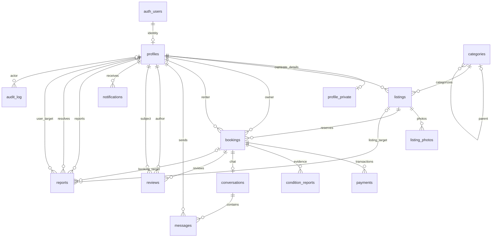

# Rentify Supabase setup and contract

## Current scope: B0.3, B0.4, B1.1, and B1.2

The initial migration creates 14 application tables, the `booking_status` enum, UUID keys, timestamps/update triggers, foreign keys, indexes, and basic integrity constraints. `profile_private` keeps phone/verification information separate from the future public profile surface.

Every table has RLS enabled. Categories allow public reads only. B1.2 adds an explicit public profile projection and owner-only name/phone edits, guarded by column privileges, RLS, and triggers; see the [profile contract](../lib/profiles/README.md). All other application tables still deny client access. Trusted server-side `service_role` access is granted explicitly; audit events permit only select/insert for that role. Rental flows remain pending.

## Local verification

Install Node.js 24, then run `npm ci`. This installs **Supabase CLI 2.121.0** from the lockfile, including its platform binary; a global CLI install is unnecessary. Use a running Docker-compatible engine. See the official [CLI setup guide](https://supabase.com/docs/guides/local-development/cli/getting-started). The CLI configuration targets PostgreSQL 17. No Supabase login, hosted project, or cloud credentials are required.

On Windows, enable WSL 2 first: open PowerShell **as Administrator**, run `wsl --install --no-distribution`, and restart if requested. Then install/start [Docker Desktop](https://docs.docker.com/desktop/setup/install/windows-install/) with the WSL 2 backend. Verify `docker info` succeeds before starting Supabase. A per-user Docker install cannot enable the Virtual Machine Platform Windows feature itself.

```sh
npm exec -- supabase --version
npm run db:start
npm run db:env
npm run db:lint
npm run db:test
npm run db:smoke
npm run dev
```

`db:start` starts the local stack and applies migrations on the first run. Studio is at <http://127.0.0.1:54323> and the test email inbox at <http://127.0.0.1:54324>. `db:env` writes only the local public URL/key and app URL to ignored `.env.local`; it refuses to overwrite an existing file and never prints credentials. It supports the CLI's public publishable key or legacy local anonymous key. Never put a service/secret key in either public variable. Restart the Next.js dev server after changing environment values.

Use `npm run db:reset` only when you intend to **discard this project's local database contents** and reapply every migration. It is explicitly local and does not use `--linked` or production credentials. `npm run db:stop` stops the stack while retaining development data. CI alone uses `--no-backup` for disposable teardown.

Person B verified this setup on Windows on **18 October 2026**, after enabling Virtual Machine Platform and restarting: WSL 3.0.3, Docker Desktop 4.95.0 (Linux engine 29.8.2), and the pinned Supabase CLI 2.121.0. Docker's installer signature and release checksum were checked before installation. Reopen existing terminals after installing Docker if they have not picked up its new PATH entry.

Local `db:start`, `db:reset`, `db:env`, `db:lint`, `db:test` (**63 checks**), `db:smoke`, and `db:types` all passed. Regenerated types matched the committed file exactly. Studio and the email inbox returned HTTP 200; `.env.local` contains only the three documented public settings and is ignored by Git. The test fixtures roll back, and categories remain empty until the seed task. [PR #9](https://github.com/eloooong/rentify-app/pull/9) is merged; its independent Linux database/API CI also passed. Hosted Supabase and deployed environments remain unconfigured. B1.1 adds local auth flows in the linked auth contract.

## Typed clients

Client Components import `createClient` from `@/lib/supabase/browser`. Server Components import the async `createClient` from `@/lib/supabase/server` and create it inside the request, never at module scope. Both use the generated `Database` type and only the public environment variables. Missing configuration fails when the client is used, so the existing placeholder app can still build without Supabase credentials.

```tsx
import { createClient } from "@/lib/supabase/server";

// Example for Person A's future component; not a shipped product route.
export default async function CategoryList() {
  const supabase = await createClient();
  const { data, error } = await supabase
    .from("categories")
    .select("id,name,slug")
    .order("name");
  if (error) throw new Error("Unable to load categories.");
  return (
    <ul>
      {data.map((category) => (
        <li key={category.id}>{category.name}</li>
      ))}
    </ul>
  );
}
```

**The component helper remains read-only.** B1.1 adds a refresh proxy, separate writable action/route clients, verified identity checks, and private auth responses. See the [auth contract and setup guide](../lib/auth/README.md) for routes, cookie handling, local email testing, and the handoff to A. Never trust `getSession()` as authorization. B1.2 adds profile permissions; listings/storage still wait for B1.3.

`db:smoke` makes real HTTP category reads, asserts category writes/private profile reads are denied, and renders a temporary Next.js Server Component using the actual server helper. Its fixture stays in ignored `tmp/`; no diagnostic route is added to the app. An empty category array is expected until B1.3/B1.4 add agreed templates/seeds. SQL tests separately exercise populated reference data for both anonymous and authenticated roles.

## Types and migration workflow

Generated types belong in `lib/supabase/database.types.ts`. They must come from the migrated database, not a handwritten approximation. Regenerate using the pinned CLI, then format with the repository's existing Prettier configuration:

```sh
npm run db:types
```

The script captures CLI output, applies the repository's Prettier settings, and writes UTF-8 only after generation/formatting succeed; a failure does not truncate the existing contract. CI uses the same script, requires an exact match with the committed file, and uploads a `database-types` artifact. A missing or outdated types file fails the check. Later schema changes require a new migration and regenerated types in the same PR. Never edit an applied migration.

The pgTAP fixtures/grants are enclosed in a rolled-back transaction. The tests exercise grant denial, RLS denial even when temporary table grants exist, trusted backend reads, audit immutability for that role, ownership consistency, and invalid values. They do not establish booking or review eligibility rules that have not been implemented. Replace foundation deny-all expectations with the intended allow/deny cases as feature-specific policies are added.

## Contract for Person A

| Entity                      | Important fields/constraints                                                                                                                                          |
| --------------------------- | --------------------------------------------------------------------------------------------------------------------------------------------------------------------- |
| `profiles`                  | `id` references Auth; `display_name`, `avatar_path`, protected `role` and `account_status`                                                                            |
| `profile_private`           | One row per profile; `phone`, `phone_verified_at`; never include in public profile queries                                                                            |
| `categories`                | `name`, `slug`, optional `parent_id`, JSON-object `attribute_schema`                                                                                                  |
| `listings`                  | `owner_id`, `category_id`, `title`, `description`, `daily_price_amount`, `deposit_amount`, `currency`, `condition`, JSON-object `attributes`, `pickup_area`, `status` |
| `listing_photos`            | `listing_id`, `storage_path`, zero-based `position`; unique position per listing                                                                                      |
| `bookings`                  | `listing_id`, `owner_id`, `renter_id`, bounded/nonempty `rental_period`, `status`, `rental_amount`, `deposit_amount`, `currency`, JSON-object `cancellation_terms`    |
| `payments`                  | `booking_id`, `type`, `amount`, `currency`, `status`, optional gateway references; no gateway integration yet                                                         |
| `condition_reports`         | One per booking/stage; JSON-array `checklist`, `photo_paths`, notes, separate party-confirmation timestamps                                                           |
| `conversations`, `messages` | One conversation per booking; messages have sender, body, and read timestamp                                                                                          |
| `reviews`                   | `booking_id`, `author_id`, `subject_id`, rating 1–5; one review per booking/author; listing is derived through booking                                                |
| `notifications`             | Recipient `user_id`, `type`, JSON-object `payload`, `read_at`                                                                                                         |
| `reports`                   | Reporter, reason/evidence, status/resolution; exactly one listing, user, or booking target                                                                            |
| `audit_log`                 | Optional actor, action, target table/ID, JSON-object details; append/read only for the server role                                                                    |

All money columns are **integer minor units**: `10000` means PHP 100.00 when currency is PHP. PHP is the plan's initial default; this does not select a gateway or settle deposit amounts. Avoid floating-point prices in API/database contracts.

Booking states: `requested`, `accepted`, `declined`, `expired`, `cancelled`, `paid`, `handed_over`, `returned`, `completed`, `disputed`. This enum defines vocabulary only; allowed transitions/actors arrive in B2.2. The owner snapshot must match the listing owner, and owner/renter must differ. Overlap protection is not present yet (B2.1).

PostgreSQL stores `daterange` canonically with an exclusive upper bound. UI date selection, billed-day semantics, booking windows, cancellations, and inspection timeouts still need agreement in `DECISIONS.md` before booking implementation. Do not infer billing rules from the range representation.

**Wait before real listing integration:** Categories are read-only and currently empty. B1.2 creates profiles on the verified user's first account-form save. B1.3 must add listing permissions, category templates, storage buckets/policies, and seeds. Later tasks must add booking transitions/overlap checks, review eligibility, chat participant policies, Realtime publication, notifications, payment webhooks, and admin/dispute logic. Use agreed UI mocks until each handoff merges. Auth integration is available from merged B1.1.

## Entity relationships



Optional report targets are mutually exclusive. Reference data, bookings, payments, and evidence use restrictive deletion where retention policy is still undecided. Account deletion/retention behavior requires a later privacy decision and migration; no automatic financial/evidence deletion policy is implied.

Sources: [RLS and table grants](https://supabase.com/docs/guides/database/postgres/row-level-security), [database testing](https://supabase.com/docs/guides/database/testing), [type generation](https://supabase.com/docs/guides/api/rest/generating-types).
