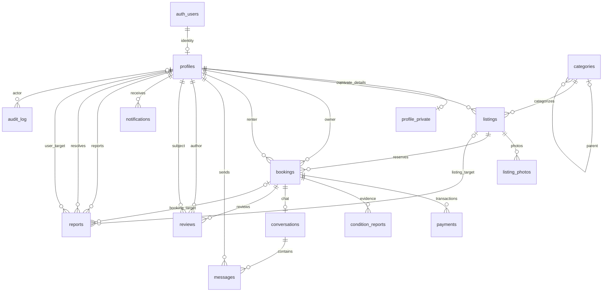

# Rentify database foundation

## Current scope: B0.3

The initial migration creates 14 application tables, the `booking_status` enum, UUID keys, timestamps/update triggers, foreign keys, indexes, and basic integrity constraints. `profile_private` keeps phone/verification information separate from the future public profile surface.

This is a schema foundation, not a working rental backend. There are **no application access policies**. Every table has RLS enabled, and all table privileges are explicitly revoked from `PUBLIC`, `anon`, and `authenticated`. Trusted server-side `service_role` access is granted explicitly; audit events permit only select/insert for that role. No browser client, including a listing owner, should access these tables yet.

## Local verification

Use **Supabase CLI 2.121.0** and a running Docker-compatible engine. See the official [CLI setup guide](https://supabase.com/docs/guides/local-development/cli/getting-started). The CLI configuration targets PostgreSQL 17. No Supabase login, hosted project, or cloud credentials are required for these disposable local checks.

```sh
supabase --version
supabase db start
supabase db reset --local --no-seed
supabase db lint --local --schema public --fail-on warning
supabase test db --local
```

`db reset --local` discards the local test database's contents and reapplies migrations. Run it only against this project's disposable development database. The workflow never uses `--linked`, a remote database URL, or production credentials. Stop your local stack with `supabase stop` when finished.

On Person B's Windows machine, the pinned CLI was downloaded to a temporary tools directory and its release checksum verified. Docker is not installed, so local reset/tests could not run there. `.github/workflows/database.yml` performs the actual reset, lint, pgTAP tests, and type generation using a disposable Linux database. B0.4 still needs the persistent local setup and typed application clients.

## Types and migration workflow

Generated types belong in `lib/supabase/database.types.ts`. They must come from the migrated database, not a handwritten approximation. Regenerate using the pinned CLI, then format with the repository's existing Prettier configuration:

```sh
supabase gen types typescript --local --schema public > lib/supabase/database.types.ts
npm exec -- prettier --write lib/supabase/database.types.ts
```

Use a UTF-8 output redirect (for example PowerShell 7 or Bash). Create the parent directory first if it does not exist. CI generates and formats the same output, compares it with the committed file, and uploads a `database-types` artifact. The initial bootstrap run can supply that artifact before the generated file is committed; every completed schema PR must include the generated file. Later schema changes require a new migration and regenerated types in the same PR. Never edit an applied migration.

The pgTAP fixtures/grants are enclosed in a rolled-back transaction. The tests exercise grant denial, RLS denial even when temporary table grants exist, trusted backend reads, audit immutability for that role, ownership consistency, and invalid values. They do not establish booking or review eligibility rules that have not been implemented. Replace foundation deny-all expectations with the intended allow/deny cases as feature-specific policies are added.

## Contract for Person A

| Entity                      | Important fields/constraints                                                                                                                                          |
| --------------------------- | --------------------------------------------------------------------------------------------------------------------------------------------------------------------- |
| `profiles`                  | `id` references Auth; `display_name`, `avatar_path`, protected `role` and `account_status`                                                                            |
| `profile_private`           | One row per profile; `phone`, `phone_verified_at`; never include in public profile queries                                                                            |
| `categories`                | `name`, `slug`, optional `parent_id`, JSON-object `attribute_schema`                                                                                                  |
| `listings`                  | `owner_id`, `category_id`, `title`, `description`, `daily_price_amount`, `deposit_amount`, `currency`, `condition`, JSON-object `attributes`, `pickup_area`, `status` |
| `listing_photos`            | `listing_id`, `storage_path`, zero-based `position`; unique position per listing                                                                                      |
| `bookings`                  | `listing_id`, `owner_id`, `renter_id`, bounded/nonempty `rental_period`, `status`, `rental_amount`, `deposit_amount`, `currency`, JSON-object `cancellation_terms`    |
| `payments`                  | `booking_id`, `type`, `amount`, `currency`, `status`, optional gateway references; no gateway integration yet                                                         |
| `condition_reports`         | One per booking/stage; JSON-array `checklist`, `photo_paths`, notes, separate party-confirmation timestamps                                                           |
| `conversations`, `messages` | One conversation per booking; messages have sender, body, and read timestamp                                                                                          |
| `reviews`                   | `booking_id`, `author_id`, `subject_id`, rating 1–5; one review per booking/author; listing is derived through booking                                                |
| `notifications`             | Recipient `user_id`, `type`, JSON-object `payload`, `read_at`                                                                                                         |
| `reports`                   | Reporter, reason/evidence, status/resolution; exactly one listing, user, or booking target                                                                            |
| `audit_log`                 | Optional actor, action, target table/ID, JSON-object details; append/read only for the server role                                                                    |

All money columns are **integer minor units**: `10000` means PHP 100.00 when currency is PHP. PHP is the plan's initial default; this does not select a gateway or settle deposit amounts. Avoid floating-point prices in API/database contracts.

Booking states: `requested`, `accepted`, `declined`, `expired`, `cancelled`, `paid`, `handed_over`, `returned`, `completed`, `disputed`. This enum defines vocabulary only; allowed transitions/actors arrive in B2.2. The owner snapshot must match the listing owner, and owner/renter must differ. Overlap protection is not present yet (B2.1).

PostgreSQL stores `daterange` canonically with an exclusive upper bound. UI date selection, billed-day semantics, booking windows, cancellations, and inspection timeouts still need agreement in `DECISIONS.md` before booking implementation. Do not infer billing rules from the range representation.

**Wait before real data integration:** B1.2/B1.3 must add profile/listing permissions, category templates, storage buckets/policies, and seeds. Profiles are not automatically created at signup yet. Later tasks must add booking transitions/overlap checks, review eligibility, chat participant policies, Realtime publication, notifications, payment webhooks, and admin/dispute logic. Use agreed UI mocks until each handoff is ready. Auth/client integration is B0.4/B1.1, not part of this migration.

## Entity relationships



Optional report targets are mutually exclusive. Reference data, bookings, payments, and evidence use restrictive deletion where retention policy is still undecided. Account deletion/retention behavior requires a later privacy decision and migration; no automatic financial/evidence deletion policy is implied.

Sources: [RLS and table grants](https://supabase.com/docs/guides/database/postgres/row-level-security), [database testing](https://supabase.com/docs/guides/database/testing), [type generation](https://supabase.com/docs/guides/api/rest/generating-types).
